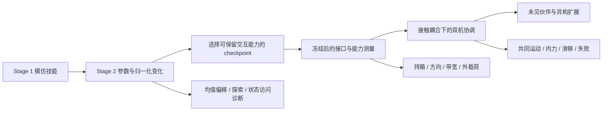
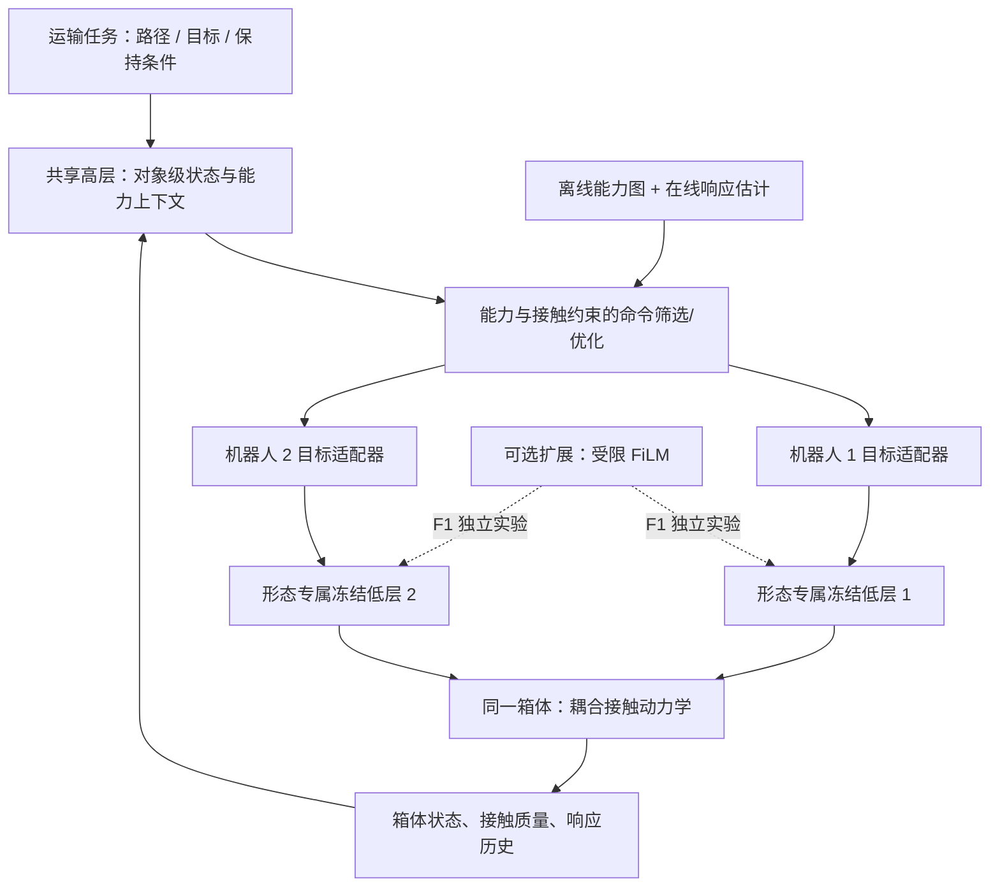
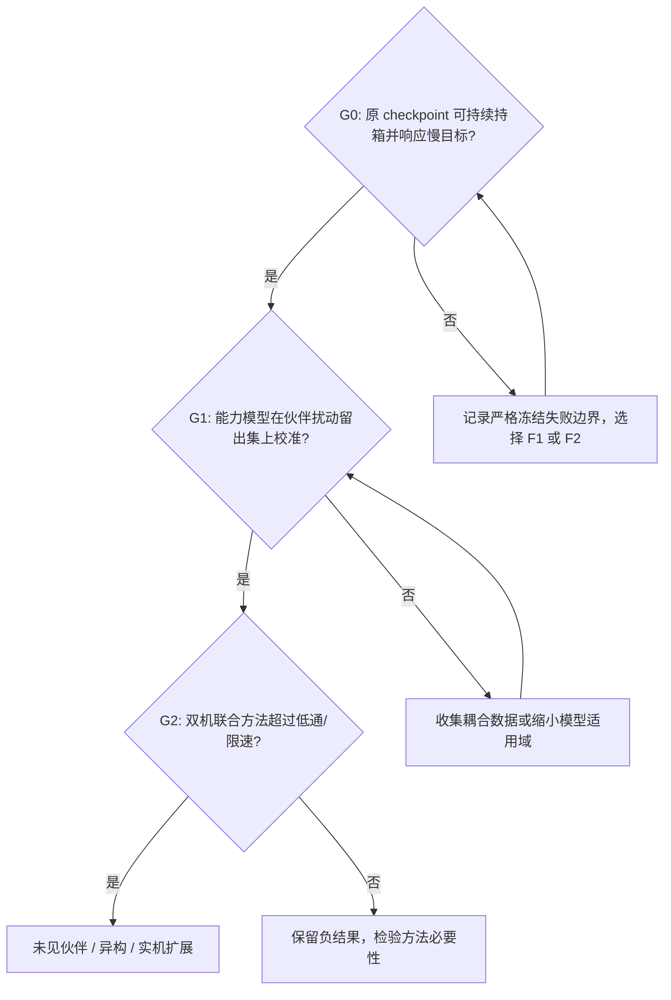

# 冻结交互技能的可组合性与双人形协作搬运：研究方案

更新：2026-11-11。依据仓库提交 `c353731999b3578c41ad5a00f896415b45e6a9f5`、当前工作区源码、两条 movebox 演示及定向检索的一手文献。

**当前判断：方向可行，但不能直接把现有单机 Actor 当成持续持箱、全向运动、可任意改变目标的控制器。最值得研究的是：冻结交互技能在什么条件下可以组合，什么条件下高层再强也必须修改低层。** 文中的“提出”“建议”“假设”均为待验证方案；已完成的是代码与文献核查、演示统计，没有运行新的训练或 checkpoint 能力测试。

本方案沿用项目文档格式，供后续实现时逐项核对。用户已确认有两台 Unitree G1，目标是 RSS 2027 第一轮投稿截止。按同构双机仿真与实机验证制定路线；GPU 预算、现有 checkpoint 性能、G1 具体版本/末端配置、定位与接触传感能力尚未确认。异构迁移是后续验证，不作为首轮已具备能力。

相关阅读：[训练机制 FAQ](hybrid-training-faq-zh.md) · [原混合训练说明](wbt-hybrid.md) · [证据与审查材料](researchwrite/dual-carry/02_evidence_table.md) · [可复现演示统计](researchwrite/dual-carry/sources/motion_coverage.json)

## 1. 研究主线与用户问题的对应关系

建议论文围绕一个可反驳的主张展开：

> 单机交互技能的组合失败，可以由命令变化速度与伙伴接触扰动下的经验能力范围部分预测；用这些范围约束共享物体目标，比仅平滑目标或约束策略分布更有效地提高双机搬运可靠性。

这句话目前是**研究假设**。若能力模型在双机中失去校准，或简单低通已经达到同样效果，都应接受反证，并解释失败来源。

| 用户关心的问题 | 本方案的判断 | 对应验证 |
|---|---|---|
| gen 是否破坏 track 学到的策略？ | 先定义“偏移”和“技能损失”；偏移可能有益，也可能有害 | 固定输入 KL、物理轨迹指标、track 保留—gen 泛化曲线 |
| std 能否体现违反程度？ | 可作为探索诊断，不能独立表示遗忘或风险 | 分离均值/尺度 KL，控制 0.45 重置和归一化影响 |
| 是否只有第 0 帧随机化？ | 不是；任意采样重置帧均有共同噪声，第 0 帧另有覆盖配置 | 检查 reset 与配置，区分初始化、参考轨迹、目标和物理扰动 |
| 冻结后能否双机搬运？ | 可做，但持续持箱、指令接口和闭链耦合是前置门槛 | 保持→慢变目标→外力→真实双机共享箱体 |
| 高层能否输出连续变化目标？ | 可以设计接口，现有 Actor 是否理解该语义必须测量 | 阶跃/斜坡/正弦目标、响应延迟和落箱边界 |
| FiLM 是否仍算冻结？ | 主干可冻结，但有效策略函数改变 | 严格冻结与可训练适配分组报告 |
| 不输入关节能否构型无关？ | 只保证输入维度不依赖关节数；还需要能力上下文和可观测状态 | 不同低层、未见伙伴与未见机器人配对 |
| RSS 研究亮点在哪里？ | 优先研究可组合条件与失败边界 | 有必要条件、可计算方法、简单基线和负结果解释 |

图 1：研究依赖关系。策略漂移诊断用于选择和理解低层，不必成为一篇论文中与协作方法并列的第二条大主线。

## 2. 必须先校正的项目事实

### 2.1 这是 GfR 思路的非官方搬箱扩展

README 明确说明本仓库为 GfR/HIL 的非官方实现与扩展。原 GfR 论文的核心实验是 parkour；论文中的辅助力、初始化和目标机制不能直接等同于本仓库发布配置。因此后续论文应写“基于当前 Hybrid-Motion-Imitation 实现的单机搬箱技能”，而不是未经核实地称为“GfR 官方搬箱策略”。[GfR 论文](https://arxiv.org/html/2602.20375v1)、[项目 README](../README.md)。

当前 Object Stage 1 全为 track，Stage 2 为 track/gen 混合，二者共享一个 Actor。Stage 2 默认恢复 Actor、Critic、归一化器和优化器，再重置动作标准差。当前 WBT 物理子步未发现施加 assistive wrench 的路径，Critic 也没有历史实验的七维辅助力观测。详见 [FAQ](hybrid-training-faq-zh.md)。

### 2.2 “只有第零帧扰动”不是当前实现的含义

实际流程是：采样参考初始帧 → 设置参考状态 → 加共同初始化噪声 → 若采样到第 0 帧，按适用配置替换根部位置/姿态噪声。共同 root 位置范围为约 `±[0.025, 0.025, 0.01] m`，还包括姿态、关节、速度等项。第 0 帧配置只对指定变量作覆盖，不表示其他帧完全精确，也不表示每一步修改了参考动作。[reset 实现](../src/holosoma/holosoma/managers/command/terms/wbt.py)、[命令配置](../src/holosoma/holosoma/config_values/wbt/g1/command.py)。

必须区分四类研究操作：

| 随机化对象 | 改变的东西 | 能否自动产生新技能？ |
|---|---|---|
| 随机参考起始帧 | 选择从动作哪个阶段开始 | 提高不同阶段覆盖，不等于产生新动作 |
| 初始状态邻域扰动 | 实际机器人/箱体起始状态偏离参考 | 可训练局部恢复，但需保证接触和动力学可行 |
| 参考轨迹增广 | 改变模仿目标序列及接触过程 | 有机会扩展技能，需验证新序列可执行 |
| 目标/物理扰动 | 改变任务意图、质量、外力等 | 可扩展任务分布，但也可能牺牲原技能 |

### 2.3 演示覆盖审计：用户对全向能力的担忧有依据

本次直接读取仓库原动作和镜像动作，统计如下。脚本为 [inspect_motion_coverage.py](researchwrite/dual-carry/sources/inspect_motion_coverage.py)，输出带输入文件 SHA256。

| 项目 | 原动作 | 镜像动作 |
|---|---:|---:|
| 帧数 / 帧率 | 325 / 50 Hz | 325 / 50 Hz |
| 首末样本间隔 | 6.48 s | 6.48 s |
| 箱体位移 x / y | 1.406 / −0.325 m | 1.406 / +0.325 m |
| 箱体初始 / 末帧 / 最大中心高度 | 0.184 / 0.183 / 0.845 m | 相同 |
| 平面速度 > 0.1 m/s 的帧数 | 192 | 192 |
| 上述运动方向在根部朝向后半平面的帧数 | 0 | 0 |

方向取箱体平面速度相对机器人根部 yaw；合计约 82.8% 的上述运动帧位于前向 ±45°。**这是全序列的演示统计，尚未分割可靠持箱接触段，也不是 Actor 能力测试。** 它支持“需要测侧移和后退”，不能直接证明策略做不到。

更关键的是：演示最终把箱体放低；Stage 2 目标仍围绕这个末帧，Z 噪声的 std/clip 仅约 0.001 m。高层要求的“持续抬箱向任意方向运动”与原有“完成搬运并放下”的目标语义不同。整体旋转演示只能改变世界朝向，不会自动增加身体坐标中的后退技能；镜像也不等于全向覆盖。

### 2.4 片段结束的 reset 是持续搬运的工程阻断点

`MotionCommand.step()` 在参考片段结束后调用 `reset(ended_env_ids)`，写回机器人和物体状态；这不是整个任务 episode 的正常终止。若原样用于协作运输，会出现参考时钟驱动的状态重置。[实现位置](../src/holosoma/holosoma/managers/command/terms/wbt.py)。

新任务必须把参考片段时钟与协作 episode 解耦，统一两机器人的箱体状态、历史缓冲和终止条件。不能分别运行两个原环境后认为它们已经在搬同一个刚体。

## 3. 如何从实验数据刻画 Stage 2 的策略偏移

### 3.1 std 为什么不够：它甚至不是 gen 独有的参数

当前 `PPOActor.std` 是每个动作维度一个可学习参数，不依赖状态，也没有独立的 track std 和 gen std。两个环境组共同更新这组参数。推理 `act_inference()` 使用均值动作。另有最小标准差约束，因此应同时记录原始参数和构造分布时的有效 std。[Actor 实现](../src/holosoma/holosoma/agents/modules/ppo_modules.py)。

因此 std 下降可能意味着探索收缩，std 上升可能意味着探索增大；二者都不直接说明模仿技能被破坏。即使 std 完全不变，均值网络也可能已经遗忘；即使 std 改变很多，确定性评估的动作也可能没有变化。0.45 的人工重置尤其会造成曲线跳变。

建议把“违反程度”拆为三种可测量对象：**策略函数偏移、访问状态分布偏移、明确物理约束的违反**。没有定义约束时使用“偏移”，避免把有益的泛化也称作违反。

### 3.2 同一输入上的 KL：把均值与探索尺度拆开

令 \(x\) 为原始 Actor 观测，包含历史、上一动作和目标；\(N_k\) 为 checkpoint \(k\) 的归一化器，\(\mu_k\) 为均值网络，\(\sigma_k\) 为有效标准差。实际策略是：

\[
\pi_k(a\mid x)=\mathcal N\!\left(\mu_k(N_k(x)),\operatorname{diag}(\sigma_k^2)\right).
\]

以 Stage 1 策略 \(\pi_0\) 为锚，对同一 \(x\) 计算 \(D_{\mathrm{KL}}(\pi_k\|\pi_0)\)：

\[
\begin{aligned}
D_\mu(x)&=\frac12\sum_j\frac{(\mu_{k,j}-\mu_{0,j})^2}{\sigma_{0,j}^2},\\
D_\sigma&=\sum_j\left[\log\frac{\sigma_{0,j}}{\sigma_{k,j}}+
\frac{\sigma_{k,j}^2}{2\sigma_{0,j}^2}-\frac12\right],\\
D_{\mathrm{KL}}(\pi_k\|\pi_0)&=D_\mu(x)+D_\sigma.
\end{aligned}
\]

这里两网络都在各自归一化后的同一原始输入上计算；当前结构下 \(D_\sigma\) 与状态无关。报告均值、分位数以及腿/腰/手臂分组，避免全身平均掩盖手臂漂移。

一个单动作维度的说明例子（不是实验结果）：若有效 std 始终为 0.1，均值从 0 变成 0.2，则 \(D_\mu=2\)，std 曲线完全看不见这个改变；若均值始终为 0，std 从 0.1 重置为 0.45，则 \(D_\sigma\approx8.12\)，但确定性推理动作完全相同。这正是必须拆分的原因。

同时记录非白化的动作均值 RMS、经动作缩放后的关节目标变化，以及动作/力矩饱和。原因是锚策略的 \(\sigma_0\) 很小时 KL 会被放大；高斯 KL 也只是裁剪前分布距离，不等于实际执行动作、接触或安全距离。[TRPO](https://proceedings.mlr.press/v37/schulman15.html) 的策略约束思想可作背景，但不能将其单一 MDP 的条件直接推广成双机接触稳定保证。

必须保存两个时间零点：**Stage 1 原 checkpoint** 和 **Stage 2 加载并重置 std、尚未优化后的 checkpoint**。后者相对前者应只有预期的尺度改变；否则存在额外加载/归一化差异。代码已有 PPO KL 是“本轮 rollout 的旧策略与更新中策略”之差，不能替代累计 Stage 1 漂移。

### 3.3 用固定观测库控制比较条件

| 观测库 | 数据来源与分层 | 回答的问题 |
|---|---|---|
| \(B_T\) | Stage 1 原任务 rollout；抓取、抬起、搬运、放下分层 | 原技能常见状态的动作是否变了？ |
| \(B_G\) | 固定目标网格，包含训练内、边界和留出区域 | 新目标输入上的响应如何变化？ |
| \(B_C\) | 后续慢变目标、外力和双机接触测试 | 协作条件下偏移是否具有预测价值？ |

保留完整原始观测及历史窗口；不能只保存单帧 q/qdot 后声称重建了原输入。评估时不更新归一化统计。分别计算 \((\mu_0,N_0),(\mu_k,N_0),(\mu_0,N_k),(\mu_k,N_k)\) 四种组合，辨别权重变化与归一化变化；由于两者交互，不能简单相减后宣称得到唯一因果贡献。

固定观测库给出“相同输入下的函数差异”，还要用每个策略自己的在线 rollout 测状态访问变化。可在固定缩放的对象级特征上计算 MMD 或最近邻距离；按目标和动作阶段匹配，并采用时间窗口。否则只因 gen 目标范围扩大就得到更大的分布距离，是定义造成的必然结果。

### 3.4 真正的结果指标应来自技能和任务

| 层面 | 推荐指标 | 常见误读 |
|---|---|---|
| Track 保留 | 完整动作完成率、根部/关节/箱体跟踪误差、抓取成功、跌倒/落箱率 | 只看平均奖励，忽略权重或 episode 长度变化 |
| Gen 泛化 | 固定目标格点成功率、到达时间、保持成功、载荷与姿态留出集 | 把训练中的课程成功率当同难度性能 |
| 控制与交互 | 手—物体相对滑移、足滑、力矩饱和、接触丢失、过大内力 | 把 KL 或 std 当物理风险 |
| 样本效率 | 固定预算下性能、达到预设成功率所需交互量 | 不区分总交互和 track/gen 各自交互 |
| 失败预测 | 漂移/能力分数预测未来 H 秒失败的 AUROC、AUPRC、校准曲线 | 用同批数据调阈值又报告预测成绩 |

训练课程会改变目标难度，当前课程 scale 变化还会重生成活跃目标。固定难度、固定载荷、固定评估种子的独立评估是必要条件。推荐同时报告确定性均值策略和随机动作策略，前者贴近当前部署行为，后者检验探索导致的失效。

### 3.5 如何检验“gen 更新损伤 track”，而不止画相关曲线

在同一参数、同一 rollout 和旧 log-prob 下，按环境 mask 取出损失：

\[
g_T=\nabla_\theta L_T,\qquad g_G=\nabla_\theta L_G,\qquad
c=\frac{g_T^\top g_G}{\|g_T\|\|g_G\|+\epsilon}.
\]

若优化目标按最小化损失写，\(c<0\) 表示局部梯度冲突。诊断时保留原 PPO 的 advantage 归一化口径，不能分别重新标准化两组再称为原算法梯度。把 std 参数与均值网络分开分析，单独处理熵项与共享正则项。

更贴近实际更新的办法是在克隆模型与优化器上执行一个 gen 更新，记录：

\[
\Delta L_T\approx g_T^\top\Delta\theta_G,
\]

并用实际前后损失、短程 rollout 复核。Adam、PPO 裁剪与多 epoch 会使原始梯度夹角不足以描述实际效果。梯度干预可参考 [PCGrad](https://arxiv.org/abs/2001.06782)，但把它加入 PPO 本身仍需单独对照，不能预设必然改善。

建议最小干预矩阵：

| 组别 | 改动 | 主要识别对象 |
|---|---|---|
| A | 原 Stage 2：混合训练，std 重置 0.45 | 发布配方基线 |
| B | 混合训练，继承 std | 人工探索重置影响 |
| C | Track-only，匹配总交互预算 | 无 gen 更新时的继续学习；同时报告任务样本不等量 |
| D | 混合训练，加 Stage 1 均值项 \(D_\mu\)，扫 2–3 个强度；std 重置同 A | 限制均值漂移是否改善保留、是否损伤泛化 |
| 扩展 | 完整 KL 保留、匹配更新幅度、固定归一化器、固定课程、gen-only、分离 Critic | 后续逐项消融，避免同时改多个因素 |

完整 KL 保留须独立成组：以 Stage 1 原策略为锚会同时约束 std，可能抵消 0.45 重置。报告其均值/尺度分量与重置的交互，不能将收益全归为减少均值遗忘。另加调低学习率或匹配实际更新 KL 的控制，检验收益是否只是来自更小更新；既记录更新幅度，也保留相同交互预算。

所有组从配对 Stage 1 checkpoint 开始，使用相同评估网格。试验性探索可先 3 个训练种子，主要结论建议至少 5 个配对种子；若要推广到“这一训练方法”而非“这个 checkpoint”，还应跨 Stage 1 种子。报告以训练种子为主要独立单位的区间，不能把并行环境 episode 当成数千个独立训练实验。资源不足时明确标注探索性结果。

最终画六组实测图：track 保留曲线；固定难度 gen 曲线；均值/尺度 KL；std 与饱和率；梯度冲突和局部更新影响；保留—泛化 Pareto 图。现在没有新训练数据，本文不画推测的性能曲线。

## 4. 随机化能否成为研究改进点

### 4.1 有空间，但“多加噪声”不足以构成主要创新

[SkillMimic](https://openaccess.thecvf.com/content/CVPR2025/html/Wang_SkillMimic_Learning_Basketball_Interaction_Skills_from_Demonstrations_CVPR_2025_paper.html) 已研究交互技能及高层组合；[SkillMimic-V2](https://arxiv.org/html/2505.02094v1) 的 STF/STG 进一步涉及参考状态邻域、可行过渡和技能连接。[HumanX](https://arxiv.org/abs/2602.02473) 也将物理感知的演示增广作为组件。因此可研究的不是“首帧改成所有帧”这个错误前提，而是：**怎样生成适合接触耦合与动态命令的可恢复邻域，并判断它是否改善技能组合。**

### 4.2 建议的增广单位：接触阶段，而非无差别逐变量噪声

抓取前、抬起、持箱、落箱对扰动的容忍不同。持箱时独立扰动手、箱体和根部，很容易制造不存在的穿透、离手或不可支撑状态。一个候选方法是在接触约束的局部切空间产生扰动：

\[
\delta x^*=\arg\min_{\delta x}\|\delta x-\epsilon\|_W^2
\quad\text{s.t.}\quad C(x)\delta x\approx0,
\quad x+\delta x\in\mathcal X_{\rm joint,ground,collision}.
\]

其中 \(C\) 来自选定接触模式的几何约束。它只给出一阶几何一致性；仍需动力学检查或短时间仿真筛选，不能因此宣称满足摩擦、力矩和稳定性约束。速度扰动也应匹配接触条件。

进一步把采样预算放到“接近失败但仍可恢复”的区域：目标变化率、横向/后向命令、持续持箱时间、伙伴等效外力、载荷份额。比较四组：当前重置噪声；简单增大同类噪声；接触条件化初始化；接触条件化初始化加动态目标/外力。**训练量、扰动幅值分布和失败重置规则应尽量匹配**，否则无法判断收益来自结构还是更多困难样本。

若当前动作缺少后退、转向和长期持箱，初始化噪声可能只训练恢复到原动作，无法补出新的稳态技能。此时需要物理可行的重定向演示、轨迹优化或独立任务训练；时间反转、镜像、整体 SE(2) 变换都不能自动保证所需动力学与接触变化。将补全后的技能再冻结，是有效研究路线，但须与“原 checkpoint 直接复用”区分。

## 5. 冻结低层用于双机搬运的可行性与硬限制

### 5.1 三种路线必须独立命名

| 路线 | 允许改变 | 能支持的主张 |
|---|---|---|
| F0：严格冻结 | 高层输入命令；Actor 权重、normalizer、动作映射均固定 | 原技能通过现有接口可以组合到什么程度 |
| F1：冻结主干加适配 | 新 FiLM/残差参数可训练，主干固定 | 有限适配能否扩展可组合范围 |
| F2：离线补全后冻结 | 先补足持箱/全向/外力技能，再固定低层 | 经准备的通用交互技能能否复用 |

F0 下同一完整输入的动作函数不变，相对“开始冻结协作时”的策略 \(\pi_{F,0}\) 有 \(D_{\rm KL}(\pi_{F,k}\|\pi_{F,0})=0\)。它若来自 Stage 2，相对 Stage 1 仍可能已有非零偏移。双机失败依然可能很严重，因为输入分布、接触和动力学变了。F1 的 backbone 即使 `requires_grad=False`，调制后的函数仍会改变。对于闭环复现，normalizer、历史含义、关节映射、PD 参数和推理时是否采样都属于冻结边界。

### 5.2 第一门槛：先测持续持箱，不先训练复杂高层

从演示持箱片段的物理一致状态开始；禁用参考片段结束的状态瞬移。比较原末帧目标、当前箱体位姿保持目标、同高度小位移目标、缓慢变化平面目标。依次测 2 s、5 s、10 s，能力允许再测 20 s；这些是实验建议时间窗，不是已有结果。

记录持续持箱时间、箱体高度/倾角、接触保持、手物滑移、脚滑、跌倒、力矩饱和。若“保持当前位置”已经不稳定，则高层很难靠低频位置目标实现连续运输。可以保留这个负结果，转 F1/F2，不能把后续失败都归因于高层训练不充分。

随后构造“方向×速度×转向×载荷×外力”的能力图。起步可用前/后/左/右/转向五类，加起停；从保守的小命令开始扫描。**最终位置可达不等于全向持箱速度可控**：策略可能先转身再前进，或放下箱子后才到目标，这对固定接触的双机任务未必可用。

### 5.3 同一个箱体目标不能自动协调两个人形

两个机器人面对面抓箱时，同一个世界运动方向可能要求一个前进、另一个后退。当前技能可能只适合特定机器人—箱体相对姿态。旋转输入并不能自动改变接触角色、箱体形状和手臂可达性，虚拟箱体观测也可能把不真实的几何交给 Actor。

此外，两个单机控制器可能都按“我承担整个箱体”来输出动作，造成过度夹紧、相互拖拽、脚滑或关节饱和。载荷分担可降低每台机器人的重力负荷，却不会自动消除控制器之间的冲突。

### 5.4 高层无关节输入仍可能部分可观测

同样的箱体与基座位姿下，机器人可能处于不同步态相位、手臂姿态、接触预紧力和饱和状态。仅输入箱体 SE(3) 与速度通常无法区分这些情况。可以保持输入维度不依赖关节数，同时加入接触模式、支撑状态、能力裕量和历史。若需要底层隐状态摘要，应验证其在不同形态间的语义，而不是假设任意 latent 都可共享。

### 5.5 风险与可解决边界

| 风险 | 能用什么证据判断 | 可能需要的改变 |
|---|---|---|
| 无法持续持箱 | 静态保持失败 | F1/F2；仅高层规划通常不够 |
| 对侧机器人必须后退而技能不支持 | 身体坐标能力图和配对接触布局 | 调整布局或补全低层，不能靠坐标变换保证 |
| 手臂可达、身高、箱宽不匹配 | 几何与接触可行性检查 | 换接触位、箱体或机器人；部分组合物理上不可行 |
| 伙伴外力导致闭环失稳 | 外力脉冲、持续载荷与双机留出测试 | 降带宽、柔顺/力反馈、适配低层 |
| 看不见内力 | 相同物体运动却不同接触载荷 | 传感或估计；纯运动状态无法唯一辨识 |
| 两策略独立稳定但组合失败 | 单机通过、共享刚体失败 | 重新辨识耦合响应，不能只交集独立成功区域 |
| 仿真接触与实机差异 | 摩擦/接触刚度/延迟变化与硬件测量 | 参数辨识、适度鲁棒训练、保守能力域 |
| 高层与低层时钟/历史不一致 | 命令切换与缓存审计 | 明确采样保持、延迟、统一 reset |

## 6. 核心理论问题：接口下的可组合性

### 6.1 从物理可行性到冻结策略的可实现性

设高层可传入低层 \(i\) 的命令为 \(u_i\)，接触模式与历史摘要为 \(c_i\)，伙伴扰动为 \(d_i\)。定义有限时间窗 \(T\) 的概率能力集合，实测近似记为 \(\widehat{\mathcal C}_i\)：

\[
\mathcal C_i(c_i;T,\alpha)=
\{u_i:\Pr(S_i\text{ 且 }V_i=0\mid c_i,u_i, d_i\sim\mathcal D_i)\ge1-\alpha\}.
\]

\(S_i\) 是明确的保持/运输完成条件，\(V_i\) 是预先列出的掉箱、跌倒等违反事件，\(\mathcal D_i\) 是公开的扰动分布。静态测试中 \(u_i\) 表示保持不变的命令；动态测试应替换为整个时间窗的命令序列 \(\mathbf u_i=(u_{i,0},\ldots,u_{i,K-1})\)，并声明采样周期和变化率。5 秒固定目标成功不能保证每 0.2 秒切换目标也成功。抓取、保持和放置分别定义，不能混用成功标准。起步可设 \(T=5\) s、\(\alpha=0.1\) 做探索，并同时报告 2/10 s；数值应在正式评估前锁定。

每个条件多次独立 reset 估计成功率，并给二项区间或分层区间。若用下置信界筛选，必须说明置信水平及多格点选择的影响。该集合是针对数据和扰动分布的经验估计，**不是对任意伙伴的安全证书**。

真正需要学习或辨识的是可执行命令的响应：

\[
(\widehat{\Delta x_o},\hat v_{c_i},\hat f_i,\hat p_{\rm fail})
=F_i(c_i,u_i,d_i;T),
\]

其中没有测力能力时删去 \(\hat f_i\)，不能凭对象运动冒充真实内力。先用单机外力扫描建模，再在双机数据上校准；若共享物体使独立模型失效，加入联合耦合修正 \(F_{12}\) 或仅保留在双机上验证过的命令区域。

### 6.2 共同物体运动与内部力

在统一参考点和坐标系表达物体 twist \(\nu_o\) 与接触 wrench \(f\)：

\[
M_o\dot\nu_o+h_o=Gf+w_{\rm ext},\qquad G=[G_1\;G_2].
\]

固定无滑移点接触的速度应满足：

\[
v_{c_i}=v_o+\omega_o\times r_i=H_i\nu_o.
\]

若有滚动、滑动或软接触，应改用对应约束，不能默认所有手掌构成理想刚性六维抓持。摩擦和接触保持仍是额外条件。

给定净 wrench，接触力存在零空间分量：

\[
f=G^\dagger w_o+N_G\lambda,\qquad GN_G=0.
\]

这说明两种接触力分配可以产生相同的物体运动；**只观察箱体位姿与速度，不能唯一恢复内部力**。这是高层状态设计的一个理论理由。分解依赖度量与接触模型，需固定坐标、力/力矩尺度和求逆方式；经典内力分析可参见 [Erhart 与 Hirche](https://mediatum.ub.tum.de/doc/1271694/901877.pdf)。

内力不是越小越好：摩擦夹持需要一定预紧力。建议约束在防滑所需的范围内，惩罚超过范围的夹紧或偏离目标载荷份额；若只惩罚 \(\|N_G^\top f\|\)，可能把箱子夹不住。仿真特权接触力与实机估计分别报告，未提供传感时不声称完成真实内力闭环。

### 6.3 一条必要条件，及其证明边界

若给定状态域、输入集合和扰动集合下，所有可实现响应都不存在满足共同运动、接触保持及平衡条件的组合，则任何仅通过该输入接口操纵冻结低层的高层都无法完成所定义任务。证明直接来自可实现响应集合的定义。

这一条件的用途是识别“必须扩大低层接口/技能”的情形。**经验能力图只是真实可达集的近似**；图上没测到不能等同于全局不存在。若要作不可能性主张，需要经验证的保守外包络或解析界，不能用采样稀疏的内估计证明不可达。

局部可操作的诊断是响应雅可比：

\[
J_i=\frac{\partial F_i^{\rm motion}}{\partial u_i},\qquad
\operatorname{rank}(J_i),\quad \sigma_{\min}(J_i).
\]

对输入/输出按物理尺度归一化后，检查是否缺少侧向、转向或高度调节方向。秩不足说明**局部一阶**控制能力不足，不是全局不可控证明；序列动作和非线性可能绕开局部限制。

### 6.4 动态目标带宽的条件性误差界

假设在明确接触模式和已验证区域内，误差满足：

\[
\|e_{k+1}\|\le\rho\|e_k\|+L_g\|\Delta g_k\|+
L_z\|\Delta z_k\|+L_d\|d_k\|+\epsilon,\qquad 0\le\rho<1.
\]

严格冻结 F0 无 \(z\) 调制项。对有界输入反复展开可得：

\[
\limsup_k\|e_k\|\le
\frac{L_g\overline{\Delta g}+L_z\overline{\Delta z}+L_d\bar d+\epsilon}{1-\rho}.
\]

它说明目标变化与伙伴扰动会共同消耗接触误差裕量，为目标速率限制提供可检验形式。\(\rho<1\)、误差界和不变区域都需建立；单次回归拟合不能证明闭环稳定。首轮可以把它作为局部模型假设，用留出数据检查误差界的覆盖率，并明确接触切换时失效。

## 7. 建议方法：测量能力，再协调可执行命令

### 7.1 架构与构型解耦的实际含义

图 2：先实现集中式共享高层、两个形态专属低层与同一个物体。去中心化执行不是用户任务的必要前提，首轮不额外增加通信约束；后续再比较局部执行和延迟。

高层输入可用固定维度的对象坐标表示：物体目标误差和 twist；各机器人基座/抓持位相对物体的位姿；接触模式和质量；最近命令与响应；能力描述（可达高度、载荷、方向速度、带宽、延迟和不确定性）。机器人集合用共享编码与置换等变聚合，每台低层仍读取自己的关节、历史和动作映射。

这叫**接口层面的形态解耦**。不同型号仍需合适的低层策略，某些机器人组合本来就不可行。只有在未见低层/机器人配对上固定高层权重测试，才能谈迁移；同型号参数共享或只换随机种子不能证明构型无关。

### 7.2 动态目标：先测接口，再决定控制频率

候选转换是高层输出物体 body-frame twist \(\xi_o\)，低层接收前视目标：

\[
T_{o,g,k}=T_{o,k}\operatorname{Exp}(\tau\widehat{\xi}_{o,k}).
\]

这里 \(T_o\in SE(3)\)，\(\xi_o\) 明确在物体自身坐标系；世界坐标 twist 应改用相应左乘表达。\(\tau\) 是前视时域，不必等于控制周期。对目标增量做平移/旋转速率限制，采用零阶保持；避免对欧拉角直接线性平均。

该转换只复用了输入维度，**不保证原 Actor 把终点位姿解释为速度命令**。先比较固定目标、阶跃、斜坡和正弦：扫幅值和频率，记录延迟、超调、持箱与失败。高层可以从 1/2/5 Hz 起测，低层频率沿用其训练设置；若慢命令也不稳定，应改技能而不是继续提频。原 Actor 的约 1 秒观测历史须保持坐标与时间含义一致。

### 7.3 如何使“能力约束”成为可执行算法

先做不依赖学习高层的版本：高层规划器给出 \(\nu_o^{\rm des}\)，枚举/采样低层实际可接收的命令对 \((u_1,u_2)\)。伙伴扰动在真实双机中由这对命令与共享动力学产生，部署时不是已知输入。因此首版明确使用少量双机数据标定的联合模型 \(F_{12}(c,u_1,u_2)\) 预测物体运动、接触响应及风险，单机 \(F_i\) 只作预筛选；若用长时域，再输入命令序列。筛选代价为：

\[
\begin{aligned}
\min_{u_1,u_2}\quad &
\|\hat\nu_o-\nu_o^{\rm des}\|_Q^2
+\lambda_u\sum_i\|u_i-u_{i,\rm prev}\|^2
+\lambda_c R_{\rm contact}+\lambda_r R_{\rm risk},\\
\text{s.t.}\quad & u_i\in\widehat{\mathcal C}_i(c_i),\quad
\|\hat v_{c_i}-H_i\hat\nu_o\|\le\varepsilon_c,\\
& \|\Delta u_i\|\le b_i,\quad \text{模型适用域与不确定性要求}.
\end{aligned}
\]

有可靠接触力估计时，再加入摩擦、预紧力和载荷分配约束。没有时，\(R_{\rm contact}\) 仅表示接触几何/滑移等可观测项。高层不能直接求出一个理想 wrench 然后假设没有力控制接口的 Actor 会执行。

这里的能力约束必须在适用的伙伴扰动/载荷份额下校准；无伙伴的单机失败不一定意味着协作失败，伙伴也可能提供支撑。若先用名义单机范围硬筛选，应把它标为保守启发式，测量误拒绝率，并用双机数据更新；不能将被筛掉的命令直接判成物理不可行。

最初用有限候选集和短视滚动优化，便于调试响应模型和不可行判定；再比较学习型高层是否改善计算速度或长时决策。无可行候选时需使用**测过的**停止/保持/放置策略，不能把“停止命令”默认视为安全。训练学习型高层时可以用相同筛选器，并记录干预率，防止模型主要依赖筛选器却把收益归给 RL。

### 7.4 FiLM：作为受限适配，而非首轮万能组件

[FiLM](https://ojs.aaai.org/index.php/AAAI/article/view/11671) 的特征仿射调制可写为：

\[
\tilde h_\ell=
\left[1+\epsilon_\gamma\tanh A_\ell(z)\right]\odot h_\ell
+\epsilon_\beta\tanh B_\ell(z).
\]

以恒等变换初始化，先验证与原 checkpoint 数值一致。\(z\) 可表达角色、协作意图或能力上下文，但这些语义不会凭空出现。独立训练低层的 latent 坐标通常不对齐，各机器人可能需要自己的适配器。

限制调制幅度与变化率，记录诱导动作差、持箱损失和响应模型变化；参数小不等于动作影响小。训练 FiLM 时需明确梯度路径：若高层随机动作就是调制系数，PPO 更新产生其分布的高层网络，低层可作为黑盒；若新可训练参数藏在确定性低层内部，而高层 log-prob 不依赖它们，普通高层 PPO 不会自动更新这些参数。后者需要包含它们的联合动作概率模型，或教师监督/蒸馏等独立目标。仅设置 `requires_grad=True` 不够；需要参数梯度的路径也不能被 `no_grad()` 截断。F1 重新测能力，不能继承 F0 的任何经验保证。

FiLM 比目标输入更有效的证据应是：在相同交互预算和参数限制下，它扩展了有用能力域，并仍保留原任务与接触约束。若只是更大的可训练网络获益，应与等参数残差适配比较。

### 7.5 高层奖励与“满足时长”

持续搬运需要密集反馈，原终点一次性 bonus 不适合每个动态子目标。可采用对象速度/路径误差、进展、倾角/滑移/落箱成本和合适的接触载荷成本。避免直接复制单机模仿轨迹作为唯一高层奖励，否则可能压制必要的协作动作。

终点完成建议要求连续保持：

\[
I_t=\mathbf1[\|p_o-p^*\|<\epsilon_p,
\ d_R(R_o,R^*)<\epsilon_R,
\ \|v_o\|<\epsilon_{\rm lin},\ \|\omega_o\|<\epsilon_{\rm ang},
\ \text{接触/高度满足任务}],
\]
\[
h_{t+1}=\begin{cases}h_t+\Delta t,&I_t=1,\\0,&I_t=0,\end{cases}
\qquad \mathrm{success}=\mathbf1[h_t\ge T_{\rm hold}].
\]

“到达并保持”合理，但要明确是抬箱保持还是放下后稳定；两种任务不能混用。保持计时在 episode/任务目标改变时重置，奖励按任务完成发一次。不要让高层每次改 `goal_version` 都获得新的终点 bonus；当前奖励去重正是按这个版本号实现的。改变高层采样周期后，还应一致处理奖励积分与折扣，例如每 \(m\) 个低层步一个高层步时，同一时间折扣可取 \(\gamma_H=\gamma_L^m\)。

## 8. 相关工作的真实竞争关系与候选创新

本次为围绕问题的定向检索，不是穷尽综述。尤其需要对以下近邻作诚实比较：

| 工作 | 已有内容，与本任务直接相关 | 本方案需要额外回答什么 |
|---|---|---|
| [GfR](https://arxiv.org/html/2602.20375v1) | 模仿与目标 RL 共同学习、稀少参考引导 | 学得全身交互技能在新接触系统中能否复用 |
| [SkillMimic / V2](https://arxiv.org/html/2505.02094v1) | 技能复用、状态邻域与过渡结构 | 接触耦合下可组合范围如何测量和利用 |
| [decMHT](https://arxiv.org/html/2609.17824v1) | 对象中心的多个人形抓取与运输，单机到多机训练；冻结行走低层，上层控制手臂等 | 冻结完整交互技能的接口限制、失败预测和约束协调 |
| [HA-DiPO](https://arxiv.org/html/2610.33584v1) | 异构协作运输、分层、冻结形态专属低层、CTDE | 手部交互技能的能力边界，及共享高层在未见低层组合中的检验 |
| [HumanX](https://arxiv.org/abs/2602.02473) | 物理感知的数据增广与人形交互迁移 | 增广能否改善已定义的双机组合能力，而非只增加单机动作数量 |

decMHT 已非常接近“双人形协作搬运”的应用目标；HA-DiPO 说明“异构+冻结低层+高层学习”也不是独立创新。它们不是因为机器人或箱子不同就可以忽略的工作。应在可获得实现和可匹配任务下复现关键基线；无法直接复现时，清楚标注依据论文实现的结构性对照，不把它冒称原作者成绩。

建议保留三项有相互依赖关系的候选贡献：

1. **可组合性的测量问题**：定义并验证带接触模式、命令变化率和伙伴扰动的有限时域能力范围，检验其对协作失效的预测价值。
2. **可执行命令的协调方法**：在真实低层响应映射下约束共同物体运动和接触一致性，证明收益超过简单低通/慢速规划。
3. **复用边界与迁移证据**：解释严格冻结何时不足、适配如何改变边界；资源允许时验证未见伙伴和异构配对。

理论优先选“必要条件 + 内力不可辨识性 + 局部指令带宽界”中与实验最贴合的一至两项，不为增加公式而承诺全局稳定。std、双 Critic、FiLM、增广都可以是诊断或消融工具；不建议首轮把它们同时包装成四个新模块。

## 9. 可执行实验协议与退出标准

### 9.1 三个必须通过的门槛

图 3：依赖门槛。循环不意味着无限尝试；每个门槛设置时间预算，并保留失败结果。

### 9.2 实验包与最小对照

| 编号 | 内容 | 关键控制 | 主要产物 |
|---|---|---|---|
| E0 | Stage 1→2 漂移审计 | 配对 checkpoint、固定观测库与目标集 | KL 分解、保留—泛化曲线 |
| E1 | 单机保持与命令响应 | 禁止片段瞬移；完整历史；固定物理配置 | 持箱时间、方向/带宽图 |
| E2 | 外载荷、外力、接触角色 | 训练/校准/测试扰动分开 | 能力模型校准与失效预测 |
| E3 | 同构双机共享物体 | 同一任务、预算、接触初始化 | 成功、滑移、内部载荷、效率 |
| E4 | 伙伴与能力不对称 | 更换低层、延迟、负载、能力削弱 | 对未见组合的稳健性 |
| E5 | 两台 G1 实机；异构为后续扩展 | 同构先验证部署差异；异构另需专属低层 | 仿真结论能否落地，以及后续固定高层迁移证据 |

E3 至少比较：直接共享动态目标；目标低通/限速；慢速 MPC 或等价规划；仅能力筛选；仅接触一致约束；二者联合。完整低层微调可作性能参考，但需计入额外交互预算，不能与严格冻结混称。F1 与 F2 的训练成本单列。

首轮可先做载荷×目标变化率二维测试，再增大扰动维度；不要一开始全因子网格导致每格样本过少。用固定测试任务报告平均值和最差条件，并列出失败类型。指标至少包括保持运输成功率、落箱/跌倒、箱体位姿/速度误差、滑移、载荷分担/超限接触力（若可测）、时间、能耗和筛选器干预率。

对已具备的两台 G1，实机验证先使用仿真中测出的保守能力域，从预设持箱、原地保持、短直线到缓慢转向逐步推进。分别记录两台的实际控制频率、时钟偏差、箱体位姿来源和接触测量来源。若没有腕部力传感或可信估计，实机主指标使用持箱、滑移、运动误差和跌倒/落箱；真实内力结论仅限有测量证据的部分。两台相同 G1 的实验能证明同构协作部署，不能证明异构迁移。

### 9.3 泛化拆分必须避免信息泄漏

- **同形态新伙伴**：换独立训练的低层或能力配置，固定高层；不能只换随机噪声。
- **能力外推**：测试未见载荷/延迟/扰动组合，说明是否超过训练数值范围。
- **形态迁移**：新机器人使用其专属低层；高层零样本与少量适配分别报告。
- **接触布局迁移**：交换抓持区域、朝向和角色，检查物理可达；不能独立重置两条互不相容的参考姿态。
- 所有超参数在开发集选，最终条件留出；若改方法后再次使用测试集，它已成为开发集。

### 9.4 不成功时怎样形成明确结论

若 E1 失败，结论是当前终点技能的接口不足，论文应缩小到复用边界或引入明确的 F2；不能继续宣称原技能直接可组合。若 E2 在单机准、双机不准，说明伙伴耦合需要显式建模。若联合方法不胜低通，应承认带宽限制已解释主要问题。若只有特权力信息有效，应将感知可实现性列为方法限制，而不是直接宣称实机适用。

## 10. 代码改动地图与建议实施顺序

以下是后续实施位置，本次仅记录方案，没有修改训练代码。

| 目标 | 当前入口 | 建议改法 |
|---|---|---|
| raw/effective std、均值、FiLM | [ppo_modules.py](../src/holosoma/holosoma/agents/modules/ppo_modules.py) | 新增只读指标接口；FiLM 用可选类，恒等初始化与旧模型兼容 |
| 固定输入漂移/梯度诊断 | [ppo.py](../src/holosoma/holosoma/agents/ppo/ppo.py) | `_rollout_step` 归一化前采样原始观测；`_compute_ppo_loss` 中分组诊断；不要改变原优化路径 |
| Stage 2 恢复与 std | 同上 `load/_maybe_reset_policy_std_on_resume` | 保存重置前后锚，记录 optimizer 与 normalizer 恢复状态 |
| 动态目标、reset 与采样 | [command/terms/wbt.py](../src/holosoma/holosoma/managers/command/terms/wbt.py) | 新建协作命令/生命周期；末帧目标和片段 reset 不直接复用 |
| Actor/高层观测 | [observation.py](../src/holosoma/holosoma/config_values/wbt/g1/observation.py) | 保留原低层维度；高层另建对象级接口、接触信息和历史 |
| 保持奖励/终止 | [reward/terms/wbt.py](../src/holosoma/holosoma/managers/reward/terms/wbt.py) 与 termination manager | 新任务级保持计时、一次完成事件、双机统一 done |
| 噪声/能力扰动 | [command.py](../src/holosoma/holosoma/config_values/wbt/g1/command.py) 与随机化管理器 | 接触模式条件化配置，独立记录训练与评估扰动 |
| 课程/评估难度 | [curriculum/terms/wbt.py](../src/holosoma/holosoma/managers/curriculum/terms/wbt.py) | 训练课程不替代固定难度评估；保存 scale 与统计状态 |
| 一个箱体、两个机器人 | [isaacsim.py](../src/holosoma/holosoma/simulator/isaacsim/isaacsim.py) 与 [wbt_manager.py](../src/holosoma/holosoma/envs/wbt/wbt_manager.py) | 两 articulation、一个 rigid object；按机器人组织张量/动作/传感；不是把 `num_envs` 翻倍 |
| 分离 imitation/task Critic | [ppo.py](../src/holosoma/holosoma/agents/ppo/ppo.py) 的模型、storage、GAE、loss、save/load | 两价值输出与各自 returns；明确任务路由或 reward 分解，保持 checkpoint 迁移可控 |

实现顺序建议：①独立诊断脚本与日志；②可持续单机测试环境；③能力采样与响应模型；④真实双机环境；⑤简单目标/低通基线；⑥联合约束；⑦再决定 FiLM 或异构。先有最小闭环再扩展，不先全面改 PPO。

分离 Critic 值得试，但不是把 value head 复制就完成：按 track/gen 分头与按 imitation/task 奖励分解是两种不同设计，后者需要分别存奖励、GAE 和终止 bootstrap。它可能减小价值拟合干扰，不能保证消除共享 Actor 梯度冲突。基线恢复时要明确旧 Critic 初始化哪个头、新头如何初始化，别用 `strict=False` 掩盖不兼容。

建议每次实验保存：代码提交/补丁、完整配置、输入 checkpoint 哈希、训练种子、环境分组种子、raw/effective std、normalizer 状态、任务分组样本数、课程状态、物理参数、评估目标集版本、命令频率和接触布局。`env_partition_seed` 只是分组种子，不能替代训练种子。

## 11. RSS 2027 首轮的实际要求与工作计划

根据 2026-11-11 核实的官方 CFP：首轮截止 **2026-12-04 23:59 AoE，即北京时间 12 月 5 日 19:59**；提交 6 页 extended abstract，最多 5 页正文加 1 页参考文献。问题、假设和方法须完整，实验可初步或尚缺；额外网页/附录不计入首轮评审。最终论文截止 2027-04-16。匿名稿不得放外部网站链接，投稿前应再复核官方要求。[RSS 2027 CFP](https://roboticsconference.org/information/cfp/)

按现在日期，首轮约剩三周半。以下是内部研究排期，**不是官方要求，也不是对设备与训练速度的保证**：

| 时间（北京时间） | 最小产物 | 决策 |
|---|---|---|
| 11/11–11/14 | 两台 G1 的控制/感知接口核对、复现 checkpoint、E1 保持测试、片段 reset 审计 | 原技能可否严格冻结复用？ |
| 11/15–11/20 | 小规模能力图、目标频响、双机共享物体最小仿真 | 若双机仍未建立，收缩论文范围，不能用架构图替代实验 |
| 11/21–11/27 | 低通/限速基线与候选联合方法，失败案例及初步多种子 | 联合建模是否必要？ |
| 11/28–12/02 | 5 页正文定稿、公式和实验协议、近邻比较 | 主张与证据一致，删除未验证性能承诺 |
| 12/03–12/05 截止前 | 匿名、格式、引用与提交检查 | 预留平台和格式问题时间 |
| 首轮后至次年 2 月 | 完善耦合建模、消融、未见伙伴实验 | 把负结果变成明确边界结论 |
| 获准继续后至 4/16 | 按 Extension Charter 完成最终验证；资源允许再上异构/实机 | 以实际评审要求重新排期 |

建议首轮 5 页内容分配：问题与近邻差异 0.75 页；能力定义与必要条件 1 页；可执行方法 1.5 页；初步实验/失败案例和正式协议 1.25 页；限制与预期洞见 0.5 页。只保留一张系统图、一张能力/失效实测图和一张核心对照表。不要把本研究计划全文直接当投稿稿。

首轮允许初步实验不代表只有想法就有竞争力。对本项目最有说服力的初步证据是：**一个可重复的组合失败案例、一个能预测该失败的测量、一个比简单限速更有效的干预**。若尚无双机结果，可以如实提交以冻结复用边界为核心的完整方法与单机证据，但不能把未运行系统写成已验证贡献。

## 12. 后续修改项目时必须保留的约束

1. 先读本文与 [训练 FAQ](hybrid-training-faq-zh.md)，确认目标属于漂移诊断、严格冻结协作还是适配扩展。
2. 不把 std、PPO 相邻更新 KL、累计技能漂移和物理违反混为一项。
3. 不把第 0 帧配置误读为仅第 0 帧有随机化；不把末帧目标自动解释成持续速度接口。
4. 记录 Actor、Critic、normalizer、optimizer、std 和课程状态分别如何恢复；更改观测布局必须处理旧 checkpoint。
5. 保留双机统一 reset、共享箱体唯一状态、目标版本和奖励的正确语义。
6. 仿真中接触力、完整状态等特权信息要与部署输入分开记录；不把形态无关维度等同于异构泛化。
7. 任何 FiLM/残差/观测归一化更新都会改变有效策略；新增后重新测能力。
8. 演示覆盖统计、能力测试、算法效果和理论条件使用不同证据标签；没有数据时不补造曲线。
9. 优先回答中心问题，不同时扩展新 Critic、新策略优化器、新增广、新高层网络和新硬件，避免无法归因。

文档维护材料：[事实与约束](researchwrite/dual-carry/01_research_canon.md)、[论证结构](researchwrite/dual-carry/03_argument_map.md)、[审查记录](researchwrite/dual-carry/qa_logs/review.md)。下一项建议实际工作是 **G0：关闭片段瞬移后的持续持箱与慢变目标测试**；其结果决定后续选择 F0、F1 还是 F2。
