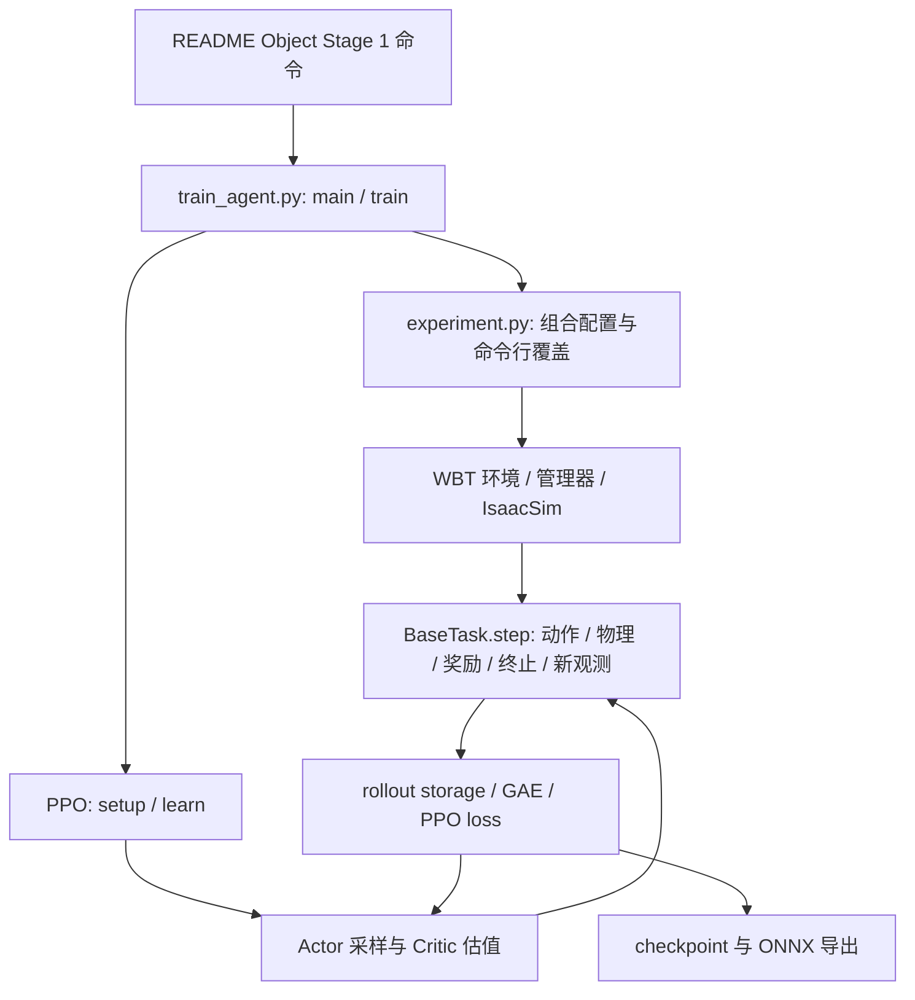

# 混合训练机制与后续实验备忘

本文整理对 README 两阶段训练及 `wbt-hybrid.md` 的疑问，重点是箱体搬运任务。它供阅读代码和规划后续改进时参考，不是对未来版本行为的保证。记录基于当前仓库的静态代码检查；修改代码、配置或依赖后，应重新核对实际行为。涉及设计动机时，下文将推测与代码事实区分。

相关阅读：[项目 README](../README.md) · [Hybrid WBT 说明](wbt-hybrid.md) · [实验配置](../src/holosoma/holosoma/config_values/wbt/g1/experiment.py) · [G1 命令配置](../src/holosoma/holosoma/config_values/wbt/g1/command.py)

后续研究：[策略偏移、冻结技能与双 G1 协作搬运方案](dual-humanoid-research-plan-zh.md)，包含实验指标、公式、能力门槛、代码改动地图及 RSS 2027 首轮计划。后续创新修改应同时核对这两份文档。

## 1. 整体训练与环境分组

**第一阶段和第二阶段分别训练什么？** README 的 Object Stage 1 将 `track_ratio` 设为 1.0，全部为参考跟踪环境；Stage 2 从第一阶段 checkpoint 恢复，并设置为 0.5，即 track 和 gen 混合训练。Track 以参考跟踪奖励为主，gen 使用扰动目标与稀疏目标奖励；共享正则项仍然生效。Actor 不直接接收逐帧参考动作，但参考动作仍用于目标、初始化、奖励及 Critic 特权信息。

**`env_partition_seed=0` 有什么用，为什么保持固定？** 它用于生成环境 ID 到 track/gen 类型的固定划分；相同环境数、比例和种子可以重现划分。每个环境的类型在仿真器生命周期中不变，但动作、参考帧、目标及噪声仍可重新采样。第一阶段全为 track，种子不改变类型结果。固定划分便于可复现统计，也与可选的每环境固定几何缩放相协调；这是工程解释，不表示动态分组在理论上不可行。见 [`HybridMotionCommand._build_fixed_env_partition`](../src/holosoma/holosoma/managers/command/terms/wbt.py)。

**Assistive wrench 只是不在观测里，还是训练中也没用？** 当前发布代码中没有发现 WBT 训练施加 assistive wrench 的路径；WBT 的物理子步仅调用 action manager。测试还确认 `assist_beta`、`assist_force_b`、`assist_torque_b` 不在当前 Critic 观测里。训练随机推搡属于另一机制。历史版本为什么加入又移除辅助力，当前代码和文档没有提供充分证据，不要臆测。见 [WBT 环境](../src/holosoma/holosoma/envs/wbt/wbt_manager.py) 和 [配置测试](../src/holosoma/holosoma/config_values/tests/test_wbt_hybrid_object.py)。

## 2. 恢复训练与策略探索

**为什么 Stage 2 把 Actor 的标准差重置为 0.45？** 这里是高斯动作分布的可学习标准差 `std`，不是网络 bias。README 配方加载 checkpoint 后，将每个动作维度的 `actor.std` 无条件设为 0.45，清除该参数对应的优化器状态，然后继续学习；Actor 均值网络和 Critic 不会因此重新初始化。旧值小于 0.45 时探索可能增强，旧值大于 0.45 时可能减弱。0.45 位于策略原始动作空间，不能直接解释为关节角度，后续还有动作缩放。一个合理的设计目的，是为新加入的 gen 条件重新设置探索尺度；0.45 是否最优需通过多种子消融验证。评估 `act_inference` 使用均值动作。见 [PPO 加载](../src/holosoma/holosoma/agents/ppo/ppo.py) 和 [PPOActor](../src/holosoma/holosoma/agents/modules/ppo_modules.py)。

**Stage 2 的 Actor 和 Critic 都恢复吗？** 是。默认 `PPO.load()` 加载 Actor、Critic、可用的观测归一化器、迭代号和受支持的环境状态；默认 `load_optimizer=True`，也加载两个优化器。接着才执行标准差重置，并清除该标准差参数的优化器状态。课程 scale/EMA 不应假设会自动从 checkpoint 恢复，须单独检查实现。

## 3. 参考帧与目标

**Track 的 adaptive 和 gen 的 uniform 各是什么？** 两者都能随机选择参考动作起始帧。Track 根据各动作时间区间的访问及失败统计调整采样概率，并混合均匀采样；gen 使用均匀采样，不是固定在动作首帧，也不是使用配置中的静态机器人初始姿态。随后代码还按概率将所选帧覆盖为该动作第 0 帧：README 的 track 为 0.05、Stage 2 gen 为 0.2。采样本身也可能选到首帧，实际首帧概率不必等于该覆盖概率。末尾采样帧还有边界处理。见 [参考动作加载、采样与重置](../src/holosoma/holosoma/managers/command/terms/wbt.py)。

**目标帧能自行选择吗？** 当前 `_compute_goal_time_steps()` 使用所选动作的 `motion_end_idx - 1`，即序列最后一帧；启用终点保持时参考序列末尾会延长终点位姿。Track 使用精确的参考终点目标，gen 在此基础上施加目标噪声。README 没有任意指定中间目标帧的参数。若修改目标产生方式，还要检查目标版本、奖励、重置、评估和可视化。

**评估 `eval_sample_random_timestep=False` 做了什么？** 评估重置从所选动作第 0 帧开始，而不是随机中间帧；它不自动关闭初始化噪声、适用的 step-zero 噪声、目标噪声、观测噪声或物理随机化。`eval_fixed_reset` 若启用则具有更高优先级。严格评估应逐项检查实际配置和随机种子。

## 4. 初始化噪声

**Common uniform initialization noise 是否改变参考动作？** 不改变参考数据或所选帧编号；它将所选帧的机器人与箱体状态加噪后写入仿真器。示例：`root_pos=[0.025,0.025,0.01]` 表示 X、Y、Z 分别从对应的 `[-a,+a]` 均匀区间采样位移。关节位置、根部姿态和速度、箱体位置等按各自配置处理。

**Step-zero configuration 是什么？** 当起始帧恰为某条参考动作自己的第 0 帧时，可用专门的裁剪高斯噪声替换机器人根部位置和姿态的普通均匀噪声；不是在均匀噪声上额外叠加，也不是 PPO 迭代 0。其他状态仍按相应规则初始化。`std` 是标准差，`clip` 是采样值的绝对裁剪上限。见 [G1 噪声配置](../src/holosoma/holosoma/config_values/wbt/g1/command.py) 和 [重置实现](../src/holosoma/holosoma/managers/command/terms/wbt.py)。

**三元组如何解释？** 位置为 X/Y/Z（m），姿态为 roll/pitch/yaw（rad），线速度为 X/Y/Z（m/s），角速度为绕 X/Y/Z 轴（rad/s）。均匀噪声的数字是半范围；高斯 `std` 是标准差，`clip` 是绝对上限。

**Object track 为什么没有列出 step-zero position/RPY？** 它没有单独设置第 0 帧高斯覆盖，并非没有噪声：仍使用共同的 `root_pos=[0.025,0.025,0.01] m` 和 `root_rot=[0.05,0.05,0.1] rad` 均匀初始化噪声。

**Object gen 的第 0 帧为何说接近参考？** 它使用位置 `std=[0.01,0.01,0.003] m`、`clip=[0.05,0.05,0.01] m`，以及姿态 `std=[0.01,0.01,0.03] rad`、`clip=[0.05,0.05,0.1] rad` 的裁剪高斯噪声。通常初始根部偏差较小。文档将其与先前 XY 约 ±0.025 m 的均匀扰动比较，但两种分布并不等价。认为这是为了降低初始接触难度是合理猜测，不是已证实的作者意图。

**Climb gen preset 和 Stage 2 recipe 是两个阶段吗？** 不是。前者是代码默认值，后者是 README Stage 2 命令行覆盖后的值。例如前者第 0 帧位置标准差是 `[0.2,0.2,0.01]`，后者为 `[0.3,0.3,0.01]`；yaw 噪声也有覆盖。按 README 执行时，以命令行最终配置为准。

## 5. 目标噪声与课程学习

**Object robot、object goal preset 和 object goal Stage 2 recipe 的区别？** `object robot` 是 object 任务 gen 环境中机器人参考目标的噪声；`object goal preset` 是代码中箱体目标噪声默认值；`object goal Stage 2 recipe` 是 README 对箱体目标噪声的覆盖。Actor 的 object 任务输入使用箱体目标，不应将机器人目标噪声误解成 Actor 也接收机器人目标。课程 scale 只作用于箱体目标噪声的 X、Y、yaw，不作用于机器人目标或箱体目标 Z、roll、pitch。见 [命令配置](../src/holosoma/holosoma/config_values/wbt/g1/command.py) 与 [Actor 观测配置](../src/holosoma/holosoma/config_values/wbt/g1/observation.py)。

**Gen success EMA 如何计算？** 对被统计的已结束 gen episode，如果其 `goal_object_reached_once` 奖励统计为正，则记成功 1，否则为 0；这是“曾经达到”，不是“结束时仍达到”。一批 episode 的成功率为 batch mean。第一次有效采样时 EMA 直接等于 batch mean；之后 `EMA_new=(1-alpha)*EMA_old+alpha*batch_mean`。默认 `alpha=0.5`。例如旧值 0.8、新批次 0.9，则新 EMA 为 0.85。alpha 越大，对新数据反应越快。

**`update_interval=20` 是多少训练？** 这里的 training step 是 PPO 外层 learning iteration；每轮当前配置收集每环境 24 个控制步。实现检查 `(iteration+1)%20==0`，只在满足条件的那一轮 rollout 收集结束的 gen episode，而不是累计前 20 轮。该轮结束有样本时更新 EMA：大于 0.90 则 scale 加 0.01，小于 0.80 则减 0.01，中间区间不变，并限制在 `[0.3,1.0]`；无结束 gen episode 则跳过。scale 改变时会立即重新应用活跃 gen 箱体目标噪声。见 [课程配置](../src/holosoma/holosoma/config_values/wbt/g1/curriculum.py) 和 [课程实现](../src/holosoma/holosoma/managers/curriculum/terms/wbt.py)。

**评估设 `initial_scale=1.0` 是否意味着 scale 无作用？** 不是。1.0 表示目标噪声课程作用轴使用完整配置尺度，仍有目标噪声；例如 X 标准差配置 0.5 m 时，scale 0.3 对应 0.15 m，scale 1.0 对应 0.5 m。评估一般不执行 PPO 训练迭代回调，因而不会像训练一样按成功率推进课程。文档称课程状态不从 checkpoint 恢复，因此配方显式指定评估初始值。

## 6. 奖励、成功与保持时间

**Gen bonus 是一次性的，能否增加保持时间？** 当前 `HybridGoalObjectReachedOnce` 判断箱体位置误差 ≤ 0.2 m 且姿态误差 ≤ π/6，并对每个目标版本发一次奖励；快速穿过目标区域也可能成功。合理的改进是要求连续保持 T 秒，结合箱体线速度、角速度、接地或松手等条件。实现应：

1. 为每个环境维护连续满足条件的计时器，条件失效时清零，以环境控制 `dt` 换算秒数。
2. episode 重置和目标版本变化时清除对应状态；区分每目标一次和每 episode 一次。
3. 同步修改课程成功统计与评估指标，避免奖励要求稳定但课程仍按瞬间通过判成功。
4. 避免一开始就设置过难条件导致奖励过稀疏；记录瞬时到达率和稳定成功率。
5. 注意现有 term 返回 `bonus/dt`，RewardManager 随后乘以 `dt`；新增奖励应明确其时间尺度。

见 [奖励实现](../src/holosoma/holosoma/managers/reward/terms/wbt.py) 和 [RewardManager](../src/holosoma/holosoma/managers/reward/manager.py)。

## 7. 箱体加载路径

**为什么创建前 `scene.rigid_objects` 可为空？** 关闭尺寸随机化的搬箱任务通过 `robot.object.object_urdf_path` 加载动态箱体，而不是要求创建前的 `simulator.config.scene.rigid_objects` 配置列表含箱体。Isaac Sim 根据 URDF 创建 `RigidObject`，然后将其加入运行时的 `self.scene.rigid_objects["object"]`。配置列表与运行时对象字典不是同一个东西。开启尺寸随机化时会走不同场景准备路径。见 [WBT 场景准备](../src/holosoma/holosoma/envs/wbt/wbt_manager.py) 和 [Isaac Sim 对象创建](../src/holosoma/holosoma/simulator/isaacsim/isaacsim.py)。

## 8. Checkpoint 兼容与评估

**“Stage 1 checkpoints … verified against current layouts” 是什么意思？** 文档指发布配方使用的特定第一阶段 checkpoint 与当前 Actor/Critic 输入布局兼容。兼容不仅是输入维度相等，还包括观测含义、顺序、历史展开和归一化状态；不能推广到所有旧 checkpoint。

**旧 checkpoint 为什么不能完整恢复？** 部分旧实验 Critic 多了 `assist_beta` 1 维、`assist_force_b` 3 维、`assist_torque_b` 3 维，共 7 维；当前 Critic 不含这些项。输入层和归一化状态形状可能不兼容，默认 `PPO.load()` 会在完整加载时失败。Actor 能否单独加载仍需检查 Actor 输入语义、顺序、网络形状及归一化状态。旧实验为何加入或移除这七维，当前资料不足以下结论。

**如何迁移旧 checkpoint？** 可选：① Actor 兼容时只迁移 Actor 及匹配的 Actor 归一化器，重新初始化 Critic、Critic 归一化器及对应优化器；② 在精确掌握特征位置和语义后映射 Critic 输入层及归一化状态；③ 使用对应旧代码和配置复现。默认加载函数没有直接的 Actor-only 开关，需要明确实现迁移。`strict=False` 不会自动修复同名形状冲突，也不能验证语义。

**评估为什么不能传 `exp:...`？** [eval_agent.py](../src/holosoma/holosoma/eval_agent.py) 先读 checkpoint 所保存的实验配置（本地 checkpoint 为 `experiment_config`；W&B 路径读取对应配置），再应用评估默认值，最后接受字段级命令行覆盖。评估入口不是重新通过训练入口的 `exp:...` 子命令选实验；应按 README 传 `--checkpoint` 及必要的字段覆盖。改变观测布局的覆盖可能导致 checkpoint 不兼容，即使维度相同也应检查语义。

## 9. 后续创新：拆分模仿与任务 Critic

**当前是否已拆分？** 当前 RewardManager 将奖励项加成总奖励，PPO 使用一个 Critic 预测总回报，并未实现独立模仿 Critic 与任务 Critic。Track 的参考奖励和 gen 的稀疏任务奖励主要来自不同环境子集；因此直接加两个网络不等于在同一条轨迹上比较两类回报。

**实验设计需要先明确：**

- 采用共享 Actor + 两个独立 Critic，还是共享 Critic 骨干 + 双价值头；两个 Critic 的特权观测是否相同。
- 将机器人/箱体跟踪项归为 imitation，将目标奖励归为 task；明确动作变化、关节限制、接触等正则项的归属，避免重复计权。
- 每个 Critic 的 loss 是否只在对应环境类型上计算；被 mask 为零的奖励究竟视为真实零回报，还是排除该样本。
- 分别计算两套 return/GAE 后，Actor 如何加权优势；“各自标准化后求和”与“求和后标准化”并不等价。
- 保持 timeout bootstrap、目标变化、episode 重置、分布式归约、日志和 checkpoint 的一致性。
- 若要研究同一轨迹同时兼顾模仿与任务，需要重新设计奖励和 mask；当前主要奖励的分工不足以直接回答这个问题。

**建议改动路线：**

1. 在 [RewardManager](../src/holosoma/holosoma/managers/reward/manager.py) 显式输出逐步分组奖励，并让 [BaseTask](../src/holosoma/holosoma/envs/base_task/base_task.py) 将其传给 rollout；episode 日志汇总不能代替逐步奖励。
2. 修改 [PPO](../src/holosoma/holosoma/agents/ppo/ppo.py) 的模型/优化器构造、storage、rollout、双 bootstrap、GAE、value loss 和 Actor 优势组合。
3. 修改 [PPO 模块](../src/holosoma/holosoma/agents/modules/ppo_modules.py) 与 [算法配置](../src/holosoma/holosoma/config_values/algo.py)，定义两个价值函数和权重。
4. 扩展 checkpoint 的两个 Critic、优化器及归一化状态；明确旧单 Critic 权重如何迁移，不能假设默认加载兼容。
5. 以原单 Critic 为基线，控制奖励、采样、初始化和计算预算；用多个随机种子分别记录 track 跟踪误差、gen 瞬时/稳定成功率、各奖励分量与两个 value 误差。

一个可作为起点的设计是 track 样本训练模仿 Critic、gen 样本训练任务 Critic，并让共享 Actor 使用对应环境的优势；这只是一个待验证的实验方案，不是唯一正确解。

## 10. 使用本备忘时的核对点

- 先读取当前代码与实验最终配置，确认本文是否仍然适用；不要仅凭此文推断代码历史或训练结果。
- README 和 `wbt-hybrid.md` 的部分阶段迭代数描述可能不同，具体实验以命令行覆盖后的最终配置为准。
- 变更目标、奖励或成功定义时，同时检查课程学习、终止、评估和日志是否仍采用同一语义。
- 变更观测、Critic 或动作分布时，检查 checkpoint、优化器状态、归一化和评估兼容性。

## 11. 第一阶段搬箱训练的代码阅读路线

以 README 的 `exp:g1-29dof-wbt-hybrid-object`、`track_ratio=1.0` 为准。不要先按整个目录逐文件阅读，先追一条“配置→一次动作→一次 PPO 更新”的完整数据链。

| 阅读顺序 | 文件与入口 | 读完应能回答什么 |
|---|---|---|
| 1 | [README](../README.md) Object Stage 1；[run_train.sh](../scripts_run/run_train.sh) | 本次实际覆盖了哪些参数？Stage 1 的 8192 环境、15000 iterations、全 track 是如何指定的？ |
| 2 | [实验注册](../src/holosoma/holosoma/config_values/experiment.py)；[G1 experiment.py](../src/holosoma/holosoma/config_values/wbt/g1/experiment.py) | alias 指向哪个配置？`hybrid_object` 从 `wbt_w_object` 和 `wbt` 继承了什么？ |
| 3 | 同目录 [command](../src/holosoma/holosoma/config_values/wbt/g1/command.py)、[observation](../src/holosoma/holosoma/config_values/wbt/g1/observation.py)、[reward](../src/holosoma/holosoma/config_values/wbt/g1/reward.py)、[termination](../src/holosoma/holosoma/config_values/wbt/g1/termination.py) | 参考如何进入训练？Actor 看什么？哪些奖励/终止只对 track 有效？ |
| 4 | [train_agent.py](../src/holosoma/holosoma/train_agent.py) 的 `main()` / `train()` | Tyro 如何生成最终配置，如何创建环境和算法，何时保存配置、加载 checkpoint、调用 `learn()`？ |
| 5 | [BaseTask](../src/holosoma/holosoma/envs/base_task/base_task.py)、[WBT 环境](../src/holosoma/holosoma/envs/wbt/wbt_manager.py) | 管理器如何组装，reset 和 step 分别改变哪些状态？ |
| 6 | [command/terms/wbt.py](../src/holosoma/holosoma/managers/command/terms/wbt.py) | `MotionLoader` 加载什么；`HybridMotionCommand` 如何固定分组、采样初始帧、添加噪声并生成目标？ |
| 7 | [PPOActor/PPOCritic](../src/holosoma/holosoma/agents/modules/ppo_modules.py)、[观测管理器](../src/holosoma/holosoma/managers/observation/manager.py) | 观测拼接、历史和归一化后输入多大；均值和 std 如何形成动作分布？ |
| 8 | [joint_control.py](../src/holosoma/holosoma/managers/action/terms/joint_control.py)、[IsaacSim](../src/holosoma/holosoma/simulator/isaacsim/isaacsim.py) | 原始动作如何缩放为关节目标/执行量，物理子步与控制步是什么关系？箱体在哪里创建？ |
| 9 | [奖励管理器](../src/holosoma/holosoma/managers/reward/manager.py)、[奖励项](../src/holosoma/holosoma/managers/reward/terms/wbt.py) | 每项计算什么、如何按环境 mask、权重与 dt 汇成 PPO 的标量 reward？ |
| 10 | [ppo.py](../src/holosoma/holosoma/agents/ppo/ppo.py) | rollout、timeout bootstrap、GAE、Actor/Critic loss、优化器、保存与恢复如何连接？ |

一次训练迭代在 `PPO.learn()` 中是：通知 `training_step=it` → `_rollout_step()` 连续收集 `num_steps_per_env` 个控制步 → 通知 rollout 结束 → `_training_step()` 按 mini-batch 和 epoch 更新 → 日志/保存。因此 iteration、环境控制步、物理子步和优化器更新不是同一个计数单位。

`_rollout_step()` 先拼原始 Actor/Critic 观测，再归一化；Actor 采样动作，Critic 估值，然后调用 `env.step()`，保存动作 log-prob、均值/std、奖励、done 与观测。rollout 末尾计算 bootstrap 与 GAE；当前 advantage 统一归一化。阅读时可跟踪 `actor_obs_raw → actor_obs → actions → rewards → returns/advantages → loss` 这几个变量，不必先读完所有辅助模块。

`BaseTask.step()` 经 action manager 处理动作，执行多个物理子步，再检查终止、算奖励、处理 reset 和新观测。WBT 与不同仿真后端的任务更新顺序有专门分支；以 `_post_physics_step()` 和 WBT 回调为准，不假定“先推进参考再算所有误差”。特别关注参考片段结束的内部 reset 与任务 episode 结束的区别。

建议三轮阅读：第一轮只看 1–4 和 PPO 主循环，建立对象关系；第二轮跟踪一次 reset 与一次 step，看 5–9；第三轮带着具体实验目标读 loss、GAE、checkpoint 与测试。当前 README 的 PPO 路线不需要先通读 `fast_sac` 或其他机器人任务。
